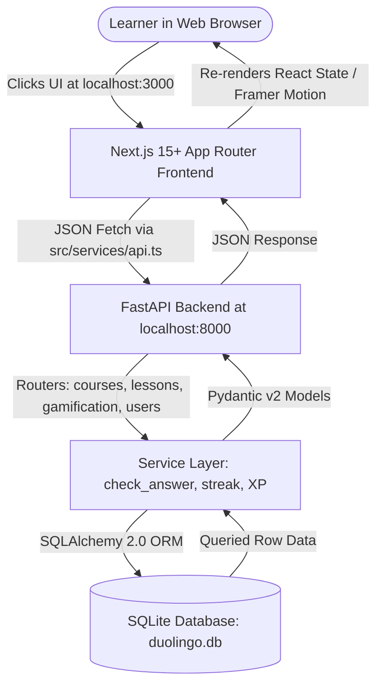
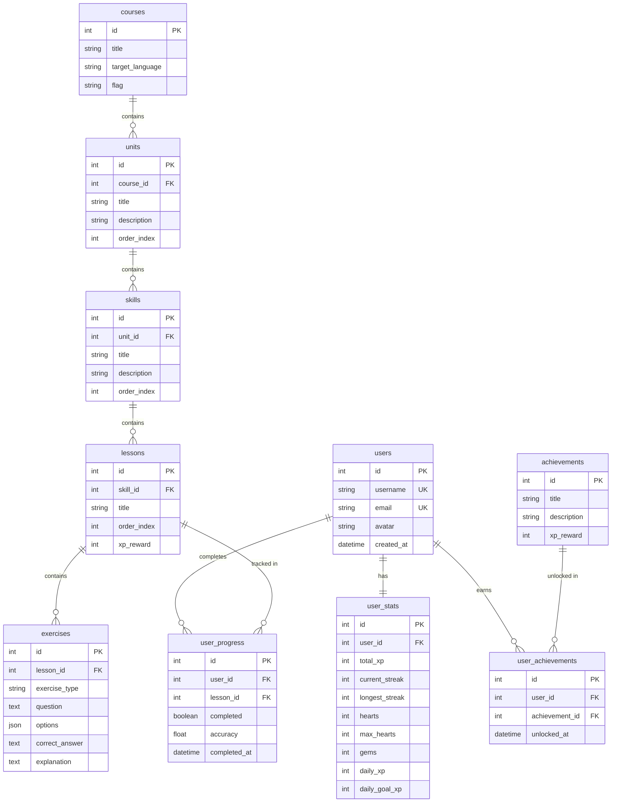

# 🦉 Duolingo Clone — Complete Project & Architecture Guide

Welcome! This comprehensive technical manual explains your entire Duolingo-inspired full-stack web application. It is designed to take you from a complete beginner to confidently understanding, running, demonstrating, and defending this architecture in technical interviews.

---

## 1. Project Overview & Architecture

### What Have You Built?
You have built a full-stack, responsive, gamified language learning web application designed after the modern Duolingo experience. It includes:
- **A Visual Learning Path** with 3 Units, 5 Skills per Unit, and 2 Lessons per skill (30 total lessons).
- **A Rich Lesson Player** supporting 5 distinct exercise mechanics (Multiple Choice, Word Bank Translation, Match Pairs, Fill-in-the-blank, and Type Answer).
- **Instant Backend Evaluation** with heart deductions, XP calculations, streak maintenance, and completion modals with confetti celebrations.
- **Persistent Gamification** via an SQLite relational database storing 12 tables.
- **Dedicated companion views** for Practice, Leaderboard, Quests, Shop, Profile, and Settings.

### Architecture Diagram



### Complete Request Flow (End-to-End Trace)
1. **User Action**: The learner clicks the active lesson node ("Lesson 3: Meeting People") on the Home screen or submits an answer inside `/lesson/3`.
2. **Next.js Frontend**: The client component (`src/app/lesson/[lessonId]/page.tsx`) collects the user answer from component state (`multipleChoiceAns`, `selectedWords`, etc.) and calls `api.submitExercise(lessonId, exerciseId, answer)`.
3. **HTTP REST Boundary**: A `POST` request with JSON payload `{ exercise_id: 11, user_answer: "I am" }` is sent to `http://localhost:8000/api/lessons/3/submit`.
4. **FastAPI Backend**: The route handler in `backend/app/routers/lessons.py` intercepts the request, validates the input using Pydantic schema `ExerciseSubmission`, and injects a database session.
5. **Business Logic & Database**:
   - `backend/app/services/gamification.py` loads `Exercise` #11 from SQLite.
   - It performs case-insensitive, whitespace-normalized answer comparison.
   - If incorrect: deducts 1 heart from `user_stats` table in SQLite, commits within a transaction.
   - If correct: flags `is_correct = True`.
6. **Backend Response**: Returns `ExerciseCheckResult` JSON containing `{ is_correct, correct_answer, explanation, hearts_remaining, out_of_hearts }`.
7. **Frontend UI Update**: Next.js updates its local `feedback` state:
   - Green or Red `FeedbackPanel` slides up from the bottom.
   - The top header Heart counter updates to match `hearts_remaining`.
   - The learner reviews the explanation and clicks **Continue**.

---

## 2. How to Run the Project (Step-by-Step for Windows)

### Prerequisites
Make sure you have:
1. **Python 3.10+** installed (`python --version`)
2. **Node.js 18+** installed (`node --version` and `npm --version`)

### Step 1: Open Windows PowerShell
Press `Win + R`, type `powershell`, and hit **Enter**.

### Step 2: Open Backend Terminal
Navigate to the backend directory:
```powershell
cd C:\Users\mosoh\.gemini\antigravity\scratch\duolingo-clone\backend
```

#### (Optional) Create & Activate a Python Virtual Environment
```powershell
# Create virtual environment
python -m venv venv

# Activate virtual environment
.\venv\Scripts\Activate.ps1
```
*(If PowerShell says script execution is disabled, run `Set-ExecutionPolicy -Scope Process -ExecutionPolicy Bypass` once).*

#### Install Backend Requirements
```powershell
pip install -r requirements.txt
```
*What this does:* Installs `fastapi`, `uvicorn`, `sqlalchemy`, and `pydantic`.

#### Seed the Database
```powershell
python seed.py
```
*What this does:* Creates `duolingo.db` with all tables, seeds 1 Spanish Course, 3 Units, 15 Skills, 30 Lessons, 150 Exercises, 10 Leaderboard competitors, achievements, and sets up your default demo user `duo_learner`.

#### Start FastAPI Server
```powershell
python -m uvicorn app.main:app --host 127.0.0.1 --port 8000 --reload
```
*What this does:* Boots up the backend on port `8000`. The `--reload` flag automatically refreshes the server whenever you edit Python files.

---

### Step 3: Open Frontend Terminal
Open a **second** PowerShell window and navigate to the frontend directory:
```powershell
cd C:\Users\mosoh\.gemini\antigravity\scratch\duolingo-clone\frontend
```

#### Install Frontend Dependencies
```powershell
npm install
```
*What this does:* Reads `package.json` and installs Next.js, React, Tailwind CSS, Lucide React, Framer Motion, and Canvas Confetti into `node_modules`.

#### Start Next.js Development Server
```powershell
npm run dev
```
*What this does:* Compiles and boots up the Next.js local development server on port `3000`.

---

### Step 4: Open Your Web Browser
Open your browser (Edge, Chrome, etc.) and go to:
- **Application Frontend**: [http://localhost:3000](http://localhost:3000)
- **Interactive Backend API Docs**: [http://127.0.0.1:8000/docs](http://127.0.0.1:8000/docs)

### How to Stop & Restart Servers
- **To Stop**: Press `Ctrl + C` in the PowerShell window running the respective server.
- **To Restart**: Simply re-run the startup command (`python -m uvicorn app.main:app --host 127.0.0.1 --port 8000 --reload` or `npm run dev`).

---

## 3. How to Use the Application

| View | Route | What to Click / What It Does |
|---|---|---|
| **Home (Learning Path)** | `/` | Shows Unit 1 banner and wavy lesson path. Completed lessons are gold with checkmarks. Current lesson (Lesson 3) is green and bouncing with a "START" bubble. Locked lessons are grey with locks. Click **START** to enter Lesson 3. |
| **Lesson Player** | `/lesson/[lessonId]` | Full-screen interactive exercise environment. Displays progress bar, heart counter, question prompt, answer interface, and check button. |
| **Multiple Choice** | Exercise 1 | Click any option card (1–4). Card turns Duolingo blue (`#DDF4FF`). Click **Check** to submit. |
| **Translate / Word Bank** | Exercise 2 | Click words in order from the bottom bank. Words move to the active sentence slot. Click an active word to send it back to the bank. |
| **Match Pairs** | Exercise 3 | Click a Spanish word on the left and its English counterpart on the right. Matching pairs lock and fade out; incorrect pairings shake with red borders. |
| **Fill in the Blank** | Exercise 4 | Click the missing word card to fill the dashed sentence blank slot. |
| **Type the Answer** | Exercise 5 | Type the translation in the input box. Evaluated case-insensitively with automatic whitespace trimming. |
| **Lesson Complete** | Finish Screen | Shows festive confetti burst, total XP earned (+15 XP), accuracy percentage, and updated daily streak. Click **Continue** to return to Home where Lesson 4 is now unlocked. |
| **Practice Hub** | `/practice` | Click **Practice (+1 Heart)** to run a quick review drill and restore a lost heart. |
| **Leaderboard** | `/leaderboard` | View Ruby League rankings. Top 3 display gold, silver, and bronze trophies. Your user (`duo_learner`) is highlighted in green. |
| **Quests** | `/quests` | View daily milestone quests: Earn 50 XP, Complete 3 lessons, and Answer 10 questions correctly. Shows live progress bars. |
| **Shop** | `/shop` | Click **Refill Free** to instantly restore hearts to 5/5. View upcoming Super Duolingo preview. |
| **Profile** | `/profile` | Shows user stats, streak count, lifetime XP, lessons completed count, and unlocked achievement badges. |
| **Settings** | `/settings` | Toggle Sound Effects, Celebration Animations, and Daily Streak Reminders. |

---

## 4. Complete Lesson Flow & Code Trace

Here is exactly how code executes across files when you play a lesson:

```
+---------------------------------------------------------------------------------------------------+
| 1. Lesson Initialization:                                                                         |
|    Frontend calls api.startLesson(3) & api.getLesson(3) in src/app/lesson/[lessonId]/page.tsx     |
|    -> Handled by backend/app/routers/lessons.py (verifies unlock status and returns exercises)    |
|                                                                                                   |
| 2. Exercise Display:                                                                             |
|    Frontend inspects exercise.exercise_type and renders the corresponding component:              |
|    - MULTIPLE_CHOICE  -> MultipleChoiceExercise.tsx                                              |
|    - TRANSLATE_WORDS  -> WordBankExercise.tsx                                                     |
|    - MATCH_PAIRS      -> MatchPairsExercise.tsx                                                   |
|    - FILL_IN_BLANK    -> FillBlankExercise.tsx                                                    |
|    - TYPE_ANSWER      -> TypeAnswerExercise.tsx                                                   |
|                                                                                                   |
| 3. Answer Submission:                                                                             |
|    Learner selects/types answer and clicks 'Check'                                                |
|    -> api.submitExercise(3, exerciseId, answer) sends POST to /api/lessons/3/submit                   |
|    -> backend/app/services/gamification.py (check_answer function) executes normalization:        |
|       clean_user = user_answer.strip().lower()                                                    |
|       clean_target = correct_answer.strip().lower()                                               |
|    -> If wrong: user.stats.hearts -= 1; db.commit()                                               |
|    -> Returns SubmitResult with explanation and hearts_remaining                                  |
|                                                                                                   |
| 4. Feedback & Progression:                                                                        |
|    FeedbackPanel.tsx renders green (success) or red (error with solution)                         |
|    Learner clicks 'Continue':                                                                     |
|    - Next exercise in lesson.exercises is loaded into view                                        |
|    - Once all exercises are done, api.completeLesson(lessonId, accuracy, correct, total) is called|
|    -> backend/app/routers/lessons.py records UserProgress(completed=True), updates total XP,       |
|       daily streak, and triggers confetti celebration in LessonCompleteModal.tsx                  |
+---------------------------------------------------------------------------------------------------+
```

---

## 5. Database Schema & Models

The database is built on SQLite and managed via SQLAlchemy ORM in `backend/app/models/__init__.py`.



### How to Inspect SQLite Database
You can inspect `duolingo.db` directly using:
1. **VS Code Extension**: Install **SQLite Viewer** (by Florian Klampfer). Right click `backend/duolingo.db` and select **Open with SQLite Viewer**.
2. **Command Line**:
```powershell
python -c "import sqlite3; con=sqlite3.connect('duolingo.db'); print(con.execute('SELECT username, total_xp, hearts FROM users JOIN user_stats ON users.id=user_stats.user_id').fetchall())"
```

---

## 6. Backend API Reference

All endpoints are built with FastAPI and documented live at `http://127.0.0.1:8000/docs`.

| Method | Endpoint | Purpose | Request Body | Response | Tables Modified / Read |
|---|---|---|---|---|---|
| `GET` | `/` | Health Check | None | `{ status: "online" }` | None |
| `GET` | `/api/users/me` | Fetch Current Demo User | None | `UserProfile` | `users`, `user_stats`, `user_progress` |
| `GET` | `/api/users/me/stats` | Fetch Gamification Stats | None | `UserStats` | `user_stats` |
| `GET` | `/api/courses/1/path` | Fetch Learning Path Tree | None | `CoursePath` | `courses`, `units`, `skills`, `lessons`, `user_progress` |
| `GET` | `/api/lessons/{id}` | Fetch Lesson & Exercises | None | `LessonDetail` | `lessons`, `exercises`, `user_progress` |
| `POST` | `/api/lessons/{id}/start` | Start Lesson Session | None | `{ message, hearts }` | `user_stats` |
| `POST` | `/api/lessons/{id}/submit` | Submit Single Answer | `{ exercise_id, user_answer }` | `SubmitResult` | `exercises`, `user_stats` (deducts heart on failure) |
| `POST` | `/api/lessons/{id}/complete` | Finalize Lesson | `{ accuracy, correct_count, total_questions }` | `CompleteLessonResult` | `user_progress`, `user_stats` (awards XP, streak) |
| `GET` | `/api/leaderboard` | Weekly Leaderboard | None | `List[LeaderboardUser]` | `users`, `user_stats` |
| `POST` | `/api/gamification/refill-hearts` | Refill Hearts | None | `{ hearts, gems, success }` | `user_stats` |
| `POST` | `/api/gamification/practice` | Practice Drill (+1 Heart) | None | `{ hearts, total_xp }` | `user_stats` |
| `GET` | `/api/profile` | Full Profile Overview | None | `UserProfile` | `users`, `user_stats`, `user_progress` |
| `GET` | `/api/achievements` | Achievements List | None | `List[Achievement]` | `achievements`, `user_achievements` |

---

## 7. Frontend Code Architecture & State Management

### Key Files in `frontend/src/`
- **`app/page.tsx`**: Main dashboard rendering `TopStatsBar`, `LearningPath`, and right-side `GamificationWidgets`. Uses `useEffect` to fetch path and stats on load.
- **`app/lesson/[lessonId]/page.tsx`**: The core interactive game loop. Manages current question index, user answers, submission state, feedback drawer, and completion modal. Wrapped in `<Suspense>` for smooth App Router client rendering.
- **`components/layout/Sidebar.tsx`**: Duolingo navigation sidebar with 3D button feel and active route highlighting.
- **`components/common/Mascot.tsx`**: Custom friendly SVG owl mascot with responsive mood variations (`happy`, `sad`, `celebrate`, `thinking`, `waving`).
- **`services/api.ts`**: Centralized HTTP client using `fetch` with unified JSON parsing and error handling.
- **`types/index.ts`**: Complete TypeScript definitions ensuring end-to-end type safety between frontend and backend.

### How State Works in the Lesson Player
In `src/app/lesson/[lessonId]/page.tsx`:
```tsx
const [currentIndex, setCurrentIndex] = useState(0);    // Which question is active
const [hearts, setHearts] = useState(5);                 // Hearts remaining
const [multipleChoiceAns, setMultipleChoiceAns] = useState(''); // Current selection
const [feedback, setFeedback] = useState<SubmitResult | null>(null); // Green/red sheet
```
1. When an answer option is clicked, `setMultipleChoiceAns(option)` activates the Duolingo blue border.
2. When the user clicks **Check**, `handleSubmit()` sends the answer to FastAPI and stores the result in `feedback`.
3. If `feedback.is_correct === false`, `hearts` is decremented. If `hearts === 0`, `setShowOutOfHearts(true)` displays the refill modal.
4. When the user clicks **Continue**, `handleContinue()` increments `currentIndex` and clears previous input state.

---

## 8. Troubleshooting Common Issues

1. **"Can't reach this page / localhost refused to connect"**:
   - **Reason**: The backend or frontend dev servers are not currently running in PowerShell.
   - **Fix**: Open two PowerShell windows and run `python -m uvicorn app.main:app --host 127.0.0.1 --port 8000 --reload` in `backend`, and `npm run dev` in `frontend`.

2. **Port 8000 or Port 3000 already in use**:
   - Find process: `Get-Process -Id (Get-NetTCPConnection -LocalPort 8000).OwningProcess`
   - Terminate it: `Stop-Process -Id <PID> -Force`

3. **CORS Error in Browser Console**:
   - FastAPI has CORS configured in `backend/app/main.py`:
     ```python
     app.add_middleware(
         CORSMiddleware,
         allow_origins=["http://localhost:3000", "http://127.0.0.1:3000", "*"],
         allow_credentials=True,
         allow_methods=["*"],
         allow_headers=["*"],
     )
     ```

4. **Database Reset**:
   - If you ever want to reset all progress back to initial demo state:
     ```powershell
     cd backend
     python seed.py
     ```

---

## 9. 5–7 Minute Evaluation Demo Script

Follow this script step-by-step when demonstrating your project to an interviewer or evaluator:

1. **Introduction (1 min)**:
   - *"Hello! Today I'm presenting my Duolingo clone built with Next.js 15+, TypeScript, Tailwind CSS, FastAPI, and SQLite."*
   - Show the browser on [http://localhost:3000](http://localhost:3000). Point out the Duolingo design system: 3D rounded buttons, clean typography, streak badge, hearts counter, and daily quest card.

2. **Learning Path & Progression (1 min)**:
   - *"Here on the home screen, you can see our vertically curved learning path across 3 Units and 30 total lessons."*
   - *"Notice that Lessons 1 and 2 are gold with checkmarks because they've been completed. Lesson 3 is green and bouncing with a 'START' bubble, while Lesson 4 onwards are locked with padlocks. The backend strictly prevents playing locked lessons."*

3. **Interactive Lesson Experience (2 mins)**:
   - Click **START** on Lesson 3 to enter `/lesson/3`.
   - **Exercise 1 (Multiple Choice)**: Select an option and click **Check**. Show the green Duolingo feedback sheet sliding up. Click **Continue**.
   - **Exercise 2 (Word Bank)**: Click word chips to form the translated sentence. Remove a chip to demonstrate bidirectional state. Submit.
   - **Heart Deduction Demo**: On the next exercise, deliberately enter an incorrect answer and click **Check**.
   - Point out: *"Notice that the red feedback panel appears with the correct solution and grammatical explanation, and our heart count in the top right immediately drops from 5 to 4 in real time."*

4. **Lesson Completion & Celebration (1 min)**:
   - Finish the remaining questions.
   - Point out the celebration screen: confetti animation, +15 XP awarded, accuracy score calculation, and streak maintenance.
   - Click **CONTINUE** to return Home: show that **Lesson 3 is now completed in gold** and **Lesson 4 is now unlocked**.

5. **Gamification & Architecture Walkthrough (1.5 mins)**:
   - Navigate to **Leaderboard**: show top 3 podium medals and active user ranking.
   - Navigate to **Profile**: show lifetime XP, completed lesson counters, and achievements.
   - Navigate to **Shop / Practice**: demonstrate the instant heart refill.
   - Open [http://127.0.0.1:8000/docs](http://127.0.0.1:8000/docs) in a new tab: *"Every single user action is verified through typed FastAPI REST endpoints with SQLite relational persistence."*

---

## 10. Technical Interview Questions & Answers

### 1. Why did you choose Next.js App Router for the frontend?
**Answer**: Next.js App Router gives us server-first rendering capabilities, modular layout nesting (`layout.tsx`), and file-system based dynamic routing (like `/lesson/[lessonId]`). It also supports fast client components with TypeScript for rich interactive game states.

### 2. Why did you choose FastAPI over Flask or Django?
**Answer**: FastAPI provides automatic OpenAPI documentation (`/docs`), native async support, and high performance. It uses Pydantic for request validation, ensuring every payload is type-checked before hitting business logic.

### 3. How does answer validation work?
**Answer**: Answers are validated on the backend in `backend/app/services/gamification.py` inside `check_answer()`. We normalize both the user submission and correct answer by trimming leading/trailing whitespace and converting to lowercase so minor punctuation or casing discrepancies do not penalize the learner.

### 4. How is lesson unlock progression enforced?
**Answer**: In `backend/app/routers/courses.py`, the backend queries all completed lesson IDs for the user from `user_progress`. It iterates through the curriculum sequentially: all lessons up to the first uncompleted one are unlocked; every subsequent lesson is marked locked.

### 5. How do you prevent duplicate XP rewards?
**Answer**: In `backend/app/routers/lessons.py`, during `complete_lesson()`, we check if a `UserProgress` record for this user and lesson already has `completed == True`. If previously completed, we return `xp_earned = 0` to prevent XP farming.

### 6. How does the streak calculation work?
**Answer**: In `backend/app/services/gamification.py`, `record_activity_and_streak()` checks `user_stats.last_activity_date`:
- If `last_activity_date == today`: Streak stays the same (no duplicate daily increments).
- If `last_activity_date == yesterday`: Streak increments by +1.
- If more than 1 day was missed: Streak resets to 1.

### 7. How are hearts deducted and refilled?
**Answer**: When an incorrect answer is submitted to `/api/lessons/{id}/submit`, `user_stats.hearts` is decremented by 1 within a database transaction. Refilling is handled via `/api/gamification/refill-hearts` or `/api/gamification/practice`.

### 8. What is CORS and how did you configure it?
**Answer**: Cross-Origin Resource Sharing (CORS) prevents malicious websites from making requests to another domain. Since Next.js runs on port `3000` and FastAPI runs on port `8000`, we enabled `CORSMiddleware` in `backend/app/main.py` allowing origins `http://localhost:3000` and `http://127.0.0.1:3000`.

### 9. Why use relational database tables instead of a single JSON document?
**Answer**: Relational design enforces data integrity via Foreign Keys (e.g. cascading deletes when a unit is removed), avoids duplication, and enables efficient queries for leaderboards, user progress, and curriculum hierarchy.

### 10. How does the Word Bank exercise handle order?
**Answer**: The user taps available word chips, appending them to a React state array `selectedWords`. Submitting joins the array with spaces (`selectedWords.join(' ')`) and sends it to the backend for sentence comparison.
